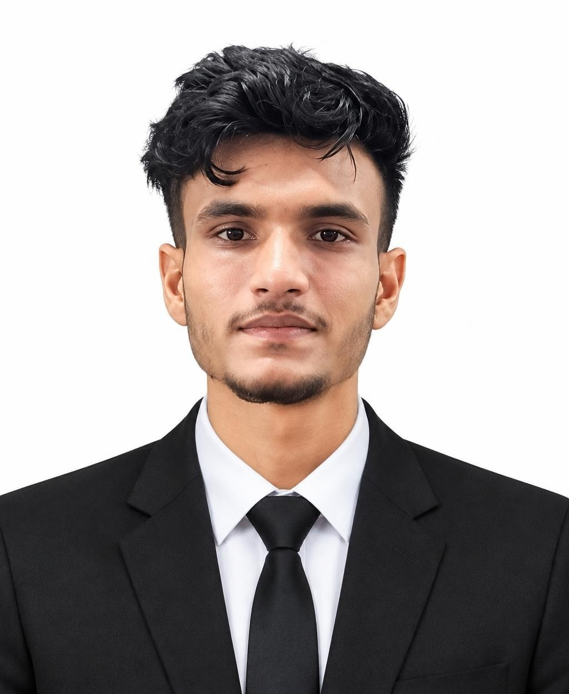

# MUSFIQUR RAHIM
### Founder & CEO of Black Shadow Team

**Founded 2022 · Publicly launched 2025–2026**

  
  
  

  

---

## About

I’m **Musfiqur Rahim**, Founder & CEO of **Black Shadow Team**. The company was established in **2022** and publicly launched/published in **2025–2026**. I’m focused on technology, cybersecurity, and digital innovation—and on creating a welcoming space to learn, share ideas, and connect with curious people.

## Core Focus

- Technology and product thinking
- Cybersecurity awareness and learning
- Digital branding and community building
- Innovation, exploration, and meaningful impact

## Connect

### Main Links

[Website](https://black-shadow-team.vercel.app/) • [LinkedIn](https://www.linkedin.com/in/musfiqur-rahim-bst/) • [GitHub](https://github.com/black-shadow-team) • [GitHub Community](https://github.com/blackshadowteamnet-netizen) • [Kaggle](https://www.kaggle.com/musfiqurrahim) • [freeCodeCamp](https://www.freecodecamp.org/blackshadowteam)

### Writing & Publishing

[Substack](https://substack.com/@blackshadowteam) • [DEV.to](https://dev.to/black_shadow_team) • [Medium](https://medium.com/@blackshadowteam.net) • [HackerNoon](https://hackernoon.com/u/black-shadow-team) • [Hashnode](https://hashnode.com/@black-shadow-team) • [Quora](https://bn.quora.com/profile/Black-Shadow-Team) • [WordPress](https://profiles.wordpress.org/blackshadowteam) • [Blogspot](https://black-shadow-team.blogspot.com/) • [DZone](https://dzone.com/users/5577855/blackshadowteam.html)

### Social Platforms

[X](https://x.com/BlackShadoTeam) • [Bluesky](https://bsky.app/profile/black-shadow-team.bsky.social) • [Instagram](https://www.instagram.com/black_shadow_team_x/) • [Threads](https://www.threads.net/@blacky_mahin_x) • [Facebook](https://www.facebook.com/profile.php?id=61591268330812) • [Facebook](https://www.facebook.com/profile.php?id=100090580510673) • [Reddit](https://www.reddit.com/user/blackshadowteamoffic/) • [Mix](https://mix.com/black_shadow_team)

---

## GitHub Overview

 

---

> “Building with curiosity. Exploring ideas that create impact.”
